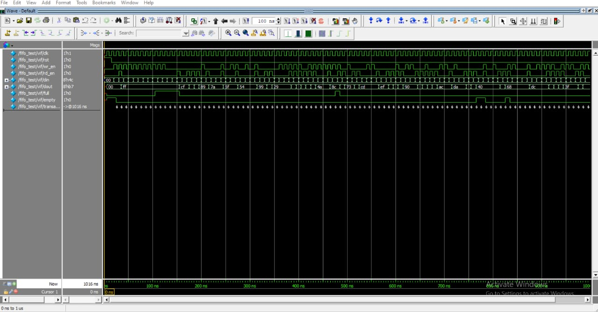

# 8-bit Synchronous FIFO Design and Verification Using SystemVerilog

## 1. Project Overview

This project implements an 8-bit synchronous FIFO (First-In First-Out) and verifies its functionality using SystemVerilog.

The FIFO has a data width of 8 bits and a depth of 8 entries. It stores incoming data and returns the oldest stored data first.

A SystemVerilog class-based verification environment generates read and write transactions, drives stimulus to the design, monitors its behavior, compares actual results against expected results using a reference queue, and collects functional coverage.

## 2. FIFO Operations

The FIFO supports the following operations:

| Operation | Condition | Description |
|---|---|---|
| Write | `wr_en && !full` | Stores input data when the FIFO is not full |
| Read | `rd_en && !empty` | Reads the oldest stored data when the FIFO is not empty |
| Full | `count == DEPTH` | Indicates that the FIFO has reached its capacity |
| Empty | `count == 0` | Indicates that the FIFO contains no data |

## 3. Inputs and Outputs

### Inputs

| Signal | Width | Description |
|---|---|---|
| `clk` | 1 bit | System clock |
| `rst` | 1 bit | Reset signal |
| `wr_en` | 1 bit | Write enable |
| `rd_en` | 1 bit | Read enable |
| `din` | 8 bits | Input data to be written |

### Outputs

| Signal | Width | Description |
|---|---|---|
| `dout` | 8 bits | FIFO output data |
| `full` | 1 bit | Indicates that the FIFO is full |
| `empty` | 1 bit | Indicates that the FIFO is empty |

## 4. RTL Design

The FIFO design is implemented using SystemVerilog sequential logic.

The design includes:

- **Memory array:** Stores FIFO data entries.
- **Write pointer:** Tracks the write position.
- **Read pointer:** Tracks the read position.
- **Occupancy counter:** Tracks the number of stored entries.
- **Full flag:** Indicates that no further writes should be accepted.
- **Empty flag:** Indicates that no data is available for reading.

The FIFO follows the First-In First-Out principle: data is read in the order in which it was written.

## 5. Verification Environment

The verification environment is developed using SystemVerilog classes.

### Verification Components

- **Transaction:** Represents a read or write operation and its associated data.
- **Generator:** Creates transactions for testing the FIFO.
- **Driver:** Applies transaction stimulus to the design.
- **Monitor:** Observes relevant input and output signals.
- **Scoreboard:** Compares the actual behavior with expected behavior.
- **Reference Queue:** Maintains the expected data ordering for comparison.
- **Environment:** Organizes the verification components.
- **Interface:** Connects the testbench and the FIFO.
- **Functional Coverage:** Tracks the defined coverage points.
- **SystemVerilog Assertions:** Check specified design behavior.

### Verification Flow

```text
Randomized Transactions
          |
          v
      Generator
          |
          v
        Mailbox
          |
          v
        Driver
          |
          v
         FIFO
          |
          v
        Monitor
          |
          v
        Mailbox
          |
          v
      Scoreboard <----- Reference Queue
          |
          v
 Expected vs Actual
          |
          v
       PASS / FAIL
```

## 6. Simulation Waveform

The waveform provides a visual reference for the FIFO's read and write activity, data signals, and status flags.



[**View Full-Size FIFO Waveform**](Fifo_waveform.jpeg)

## 7. Tools and Technologies

- SystemVerilog
- RTL Design
- Class-Based Verification
- Randomized Stimulus
- Mailbox-Based Communication
- Scoreboard-Based Checking
- Reference Queue
- Functional Coverage
- SystemVerilog Assertions
- QuestaSim

## 8. Repository Structure

```text
fifo-systemverilog-verification/
├── rtl/
├── tb/
├── simulation/
├── Fifo_waveform.jpeg
└── README.md
```

## 9. Learning Outcomes

This project demonstrates the fundamentals of synchronous FIFO design and functional verification, including read and write control, pointer-based storage management, status flags, transaction generation, monitoring, reference-model checking, and waveform analysis.

## Author

**Kethana Rakshitha**

GitHub: [kethana-rakshitha](https://github.com/kethana-rakshitha)
